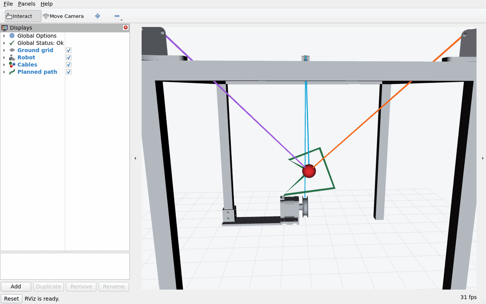
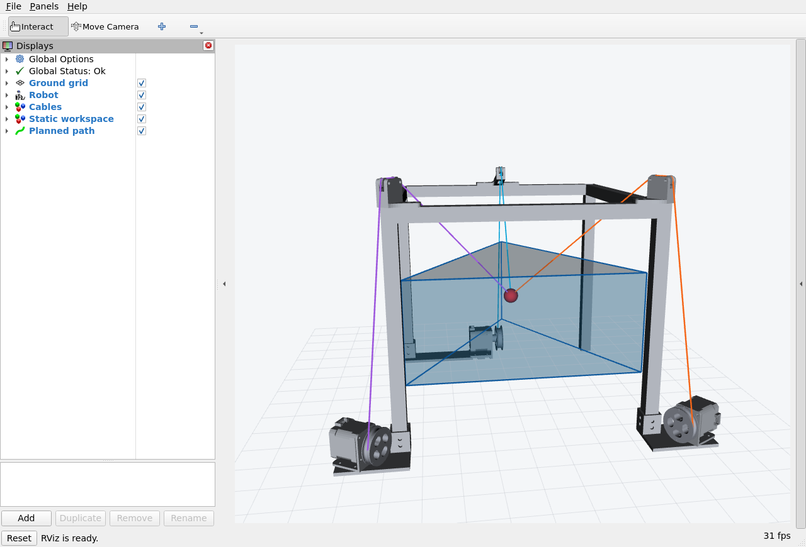
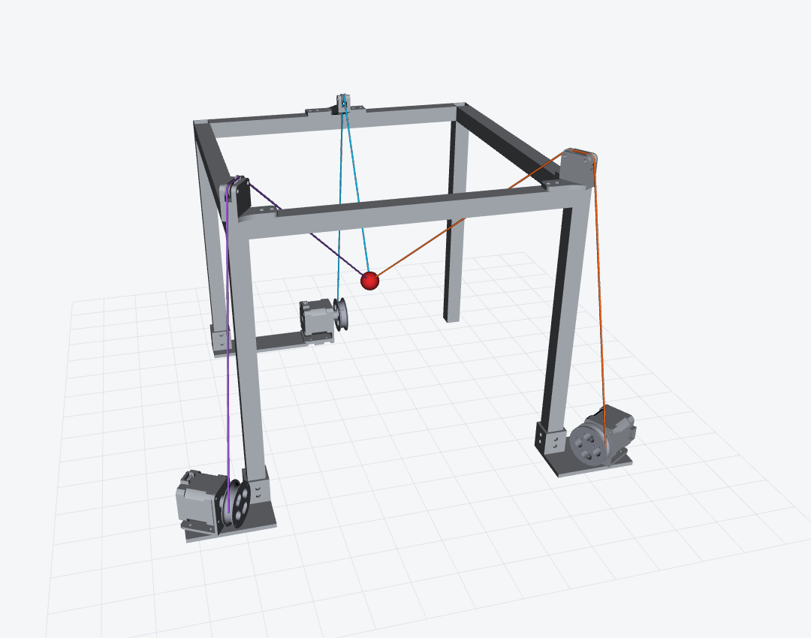
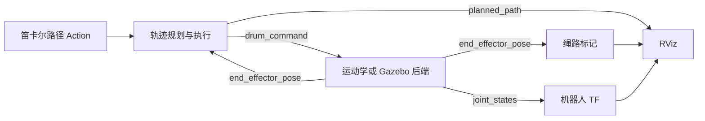

# Cable-Driven Parallel Robot

`ropes_ws` 是三绳驱动并联机器人的 ROS 2 Humble 工作空间。三根绳汇到一个球形挂点，控制末端在 `base_link` 中的 XYZ 位置。工作空间提供正逆运动学服务、笛卡尔路径 Action、RViz 展示和 Gazebo 11 动力学仿真。原有 CAD 网格、滑轮路径、卷筒坐标和零位标定集中在描述包。

## 模型与轨迹演示

### RViz 末端轨迹



运动学仿真中，红球沿绿色规划路径依次到达五个航点，最后回到零位。

### RViz 末端可达区域



RViz 默认开启 `Static workspace` 图层。蓝色半透明区域表示 `base_link` 下末端球心的静态工作空间。默认区域为三个出线点的 XY 投影围成的三角柱，Z 高度为 `90–240 mm`。三角柱侧面是绳索失去张力的极限，规划目标应位于三角形内部。自定义标定中若绳长或导向平面进一步限制范围，图层显示静态工作空间内的保守三角柱。实机可用范围还取决于卷筒标定行程和机械净空。

### URDF 零位模型



## GitHub 参考

- `Tachia/cdpr_ros2_ws` 将机器人描述、控制和 Gazebo 插件分包，其工作空间使用 ROS 2 Jazzy 与 Gazebo Harmonic。本项目参考其职责划分，按本机的 Humble 与 Gazebo 11 实现。[cdpr_ros2_ws](https://github.com/Tachia/cdpr_ros2_ws)
- CASPR 提供绳驱并联系统的正逆运动学、动力学和工作空间分析，适合作为张力与可行域建模的参考。[CASPR](https://github.com/darwinlau/CASPR)
- `balazs-bamer/cdpr-simulation` 是采用 ROS Melodic 的 Gazebo 绳驱仿真项目，可参考将绳力施加到负载的实现思路。[cdpr-simulation](https://github.com/balazs-bamer/cdpr-simulation)
- 源包放在 `src/`，工作区通过 `colcon` 构建并以 overlay 加载。[ROS 2 Humble 工作空间教程](https://github.com/ros2/ros2_documentation/blob/humble/source/Tutorials/Beginner-Client-Libraries/Creating-A-Workspace/Creating-A-Workspace.rst)

## 工程结构

```text
ropes_ws/
├── firmware/ropes_ble_gateway/   # ESP32-S3 的 BLE 到三路 UART 固件
└── src/
    ├── ropes_description/   # CAD 网格、URDF、标定配置、RViz 配置
    ├── ropes_interfaces/    # ROS 消息、服务、Action 定义
    ├── ropes_kinematics/    # 可独立调用的几何模型、ROS 正逆解服务
    ├── ropes_motion/        # 笛卡尔规划、限速、Action 执行
    ├── ropes_simulation/    # 理想运动学后端和 Gazebo 绳力插件
    ├── ropes_hardware/      # USB 与 Bluetooth、驱动反馈、实机标定和门控
    └── ropes_bringup/       # 系统启动、手动控制、绳路可视化
```

规划器从 `end_effector_pose` 获取当前末端位置，规划后向 `drum_command` 发送三个卷筒的累计目标角。两种仿真后端使用同一套接口，并发布各自的末端状态和 `joint_states`。`robot_state_publisher` 根据状态更新 TF，RViz 叠加绳路和规划路径。手动模式经相同的逆解或正解检查后发布卷筒命令，每次启动选择一个上层命令来源。包名、可执行程序、话题、服务和参数采用 `snake_case`，自定义 ROS 类型采用 `PascalCase`。



## 构建与运行

目标环境为 Ubuntu 22.04、ROS 2 Humble、Gazebo Classic 11。首次使用时克隆仓库并进入工作空间。

```bash
git clone https://github.com/Woh43/cable-driven-parallel-robot.git ropes_ws
cd ropes_ws
```

在工作空间根目录构建并加载 ROS 2 环境。

```bash
source /opt/ros/humble/setup.bash
rosdep install --from-paths src --ignore-src --rosdistro humble -r -y
colcon build --symlink-install
source install/setup.bash
```

运动学模式启动 RViz，可以快速检查工作空间和轨迹，卷筒命令经理想正解直接更新模型。

```bash
ros2 launch ropes_bringup simulation.launch.py backend:=kinematic
```

动力学模式启动 Gazebo 和 RViz，可以在 RViz 查看走绳、规划路径和实际末端位置。两个模式都可以用 `rviz:=false` 禁用 RViz，Gazebo 模式可以用 `gazebo_gui:=false` 执行无界面仿真。

```bash
ros2 launch ropes_bringup simulation.launch.py backend:=gazebo
```

真机提供 USB 三串口和 ESP32 三路 UART 的 BLE 两个后端。两者使用 `hardware.launch.py`，通过实机 YAML 中的 `transport` 选择，默认真机命名空间为 `/ropes_real`。上机步骤见 [实机接入](docs/hardware.md)，ESP32 烧录、配对和通道配置见 [Bluetooth 网关](docs/bluetooth.md)。

在另一终端加载 `install/setup.bash` 后发送绝对坐标的路径。系统从当前观测位置出发，依次通过航点，各航点处的规划速度为零。以下路径最后返回零位。

```bash
ros2 action send_goal /follow_cartesian_path ropes_interfaces/action/FollowCartesianPath \
  '{header: {frame_id: base_link}, waypoints: [{x: 0.03, y: 0.0, z: 0.17}, {x: 0.0, y: 0.025, z: 0.15}, {x: -0.025, y: 0.0, z: 0.19}, {x: 0.0, y: 0.0, z: 0.17}]}' \
  --feedback
```

每一段沿空间直线使用五次多项式做时间参数化，段两端的速度和加速度为零。段时间按配置约束连续笛卡尔速度、加速度和卷筒转速，并检查全段在重力和计划加速度下能否保持正张力。Action 反馈提供段序号、时间进度和观测位置，末端进入终点容差并稳定后返回成功。默认限制是 `0.06 m/s`、`0.18 m/s²`、各卷筒 `4.0 rad/s`，命令频率为 `50 Hz`。可通过 `trajectory_config_path` 加载另一份 `trajectory.yaml`。Gazebo 模式使用当前仿真重力规划，规划转速也受仿真卷筒速度上限约束。仿真中的轨迹命令附带卷筒角速度，Gazebo 用其平滑指令间的收放绳速度。

## 运动学服务与手动模式

逆解计算目标到出线点的距离，再通过卷筒半径和收放方向换算累计角度。正解从三个角度换算自由绳长，求三球交会在出线平面下方的分支，并校验绳长预算、高度、奇异位形和静态张紧条件。正逆解与规划共用同一几何模型。服务失败时返回可读原因。

```bash
ros2 service call /compute_inverse_kinematics ropes_interfaces/srv/ComputeInverseKinematics \
  '{target: {header: {frame_id: base_link}, point: {x: 0.0, y: 0.0, z: 0.15}}}'

ros2 service call /compute_forward_kinematics ropes_interfaces/srv/ComputeForwardKinematics \
  '{drum_state: {name: [drum_1_joint, drum_2_joint, drum_3_joint], position: [0.0, 0.0, 0.0]}}'
```

手动滑块保留 XYZ 偏移与卷筒两种控制模式。XYZ 滑块使用相对标定零位的偏移，单位为米。卷筒滑块使用相对标定零位的角度，单位为弧度。X、Y 默认滑块范围为 ±35 mm，Z 默认偏移范围为 −80 至 +70 mm。

```bash
ros2 launch ropes_bringup display.launch.py control:=xyz
ros2 launch ropes_bringup display.launch.py control:=drum
```

编程控制时，以 `ros2 launch ropes_bringup display.launch.py control:=xyz gui:=false` 启动后，可以向目标话题发送绝对坐标。以 `control:=drum gui:=false` 启动时，在同一条 `JointState` 消息里向 `/drum_joint_states` 发送全部三个卷筒的名称和角度。

```bash
ros2 topic pub --once /end_effector_target geometry_msgs/msg/PointStamped \
  '{header: {frame_id: base_link}, point: {x: 0.0, y: 0.0, z: 0.15}}'
```

| 话题 | 类型 | 用途 |
| --- | --- | --- |
| `/drum_command` | `sensor_msgs/msg/JointState` | 三个具名卷筒的累计角度命令，单位 rad |
| `/end_effector_pose` | `geometry_msgs/msg/PointStamped` | 仿真观测末端绝对坐标，单位 m |
| `/joint_states` | `sensor_msgs/msg/JointState` | 卷筒角度和用于 TF 的三轴末端位移 |
| `/planned_path` | `nav_msgs/msg/Path` | 最近一次规划的笛卡尔折线 |
| `/cable_paths` | `visualization_msgs/msg/MarkerArray` | 三条绳路的 RViz 标记 |
| `/static_workspace` | `visualization_msgs/msg/MarkerArray` | 末端静态工作空间的半透明区域和边线 |
| `/cable_tensions` | `ropes_interfaces/msg/CableTensions` | Gazebo 中的三个具名绳张力，单位 N |

## 标定与仿真模型

几何数据在 [`cables.json`](src/ropes_description/config/cables.json)。默认零位为 `(0, 0, 0.17) m`，末端球直径 `24 mm`，允许高度 `0.09–0.24 m`。三根绳均预裁 `1.30 m`，卷筒槽底半径 `20 mm`，按 `0.6 mm` 绳径和单层卷绕取有效半径 `20.3 mm`。绳长预算计入固定走绳段、保留三圈和两端合计 `80 mm` 的固定余量。

| 绳号 | CAD 导向轮 | 出线点 XYZ (mm) | 零位末段 / 外露总长 / 可额外放绳 (mm) |
| --- | --- | --- | --- |
| 1（橙） | V624ZZ-6 → V624ZZ-2 | 170.544, −163.621, 373.869 | 312 / 685 / 153 |
| 2（蓝） | V624ZZ-3 | 0.000, 127.367, 372.766 | 239 / 588 / 249 |
| 3（紫） | V624ZZ-1 → V624ZZ-4 | −170.544, −163.621, 373.869 | 312 / 685 / 153 |

Gazebo 使用集中的末端质量、重力和单向弹簧阻尼模型计算绳力。卷筒位置由限速收放模型推进，松绳时张力为零。固定出线点、恒定卷绕半径和直线末段适用于运动学与控制验证。模型精度取决于实际载荷、绳材、导向轮摩擦、挠垂和排线，需要实测这些量才能校准动力学。接入实机前应在统一坐标系下校准出线点、卷筒零位、收放方向和放绳边界。`config_path` 替换标定文件，`simulation_config_path` 替换 Gazebo 的质量、绳刚度、阻尼及卷筒速度等参数。

## 验证

```bash
colcon test
colcon test-result --verbose
ros2 launch ropes_bringup simulation.launch.py backend:=gazebo rviz:=false gazebo_gui:=false
```

测试覆盖正逆解互验证、工作空间边界、张力、解析雅可比及轨迹限速等数值场景。Gazebo 启动后可以用 `/cable_tensions`、`/end_effector_pose` 和 Action 反馈核对动态响应。
